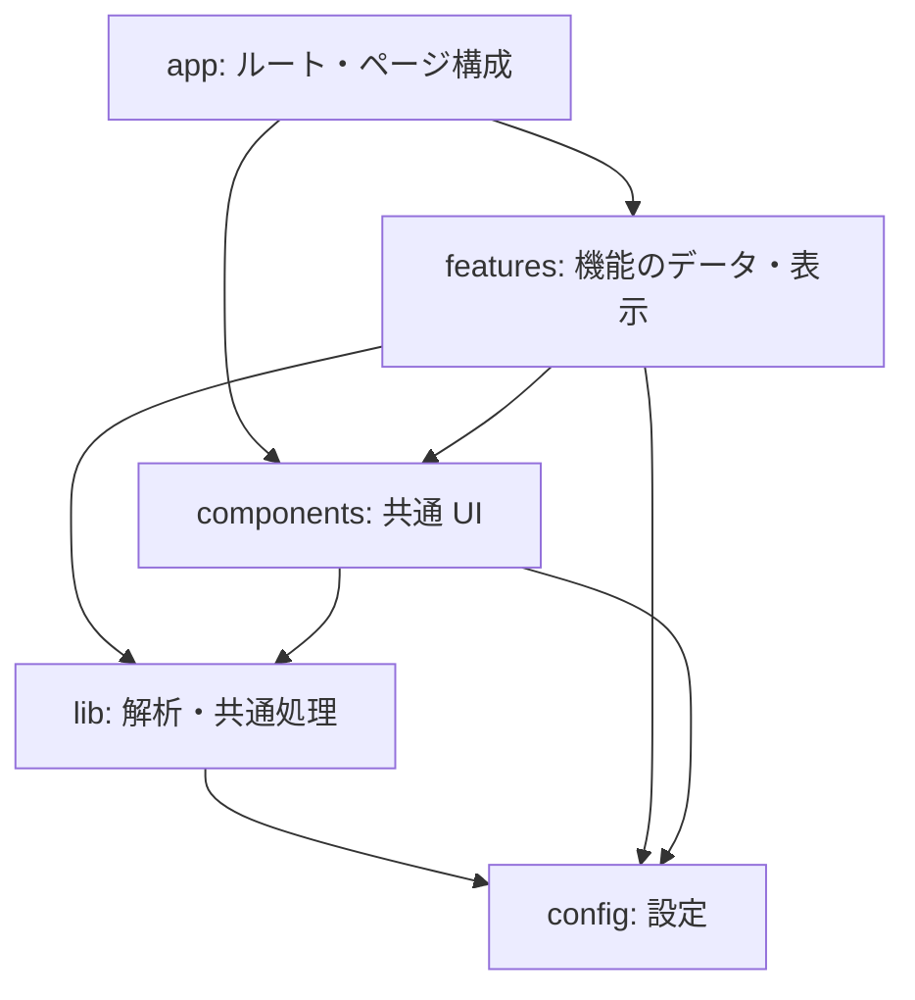

# 構成と設計上の判断

Next.js のページが `features` のデータ取得・検証を呼び出し、`components`、`lib`、`config` を組み合わせて表示します。
機能間の組合せは `app` で扱います。共有コードからページや個別機能への依存は作りません。

`config` は共有処理や UI に依存せず、`lib` と `hooks` は UI を import しません。
機能内でもスキーマ、料金、日付、サーバー処理から表示コンポーネントへの依存は禁止します。
大会ページ全体の組立てと年度ナビゲーションは `app/competitions/_components` が担当し、
ホームの大会告知には `app` から選択済みのデータを渡します。

ニュースは Git で管理し、`features/news/server/news.ts` で読み込みます。
ページはこのモジュールを直接使い、外部向けのニュース API を経由しません。
記事本文の変更はデプロイで公開します。別のキャッシュ更新手順は設けていません。
ファイルの列挙・読込と、記事形式の解析を分離し、API の日付変換や応答形式は HTTP 境界で扱います。

Markdown の解析は `lib/markdown`、React 描画は `components/Markdown` が担当します。
一つの構文木を本文と目次で共有するため、重複見出しや HTML の見出しでもアンカーが一致します。
SVG アイコンや OpenGraph 画像の描画も `components` に置き、設定ファイルには値だけを保存します。

大会データは年度ごとに登録します。表示年度は編集時に決めるため、現在の日付から自動では切り替えません。
年度を追加するときは [website README](packages/website/README.md#大会年度の追加) に従ってください。

入会・推薦の金額と掲載資料は各機能のデータとして管理します。公開済みの金額を保持し、
料金計算や適用条件を推測するロジックは設けません。金額と表示位置の対応は回帰テストで確認します。

`server-only` が付いたモジュールへの依存は、クライアントコードから間接的に参照している場合も検査します。
`npm run lint:architecture` が機能間の依存とクライアント／サーバー境界を、dependency-cruiser が循環参照と未解決の import を検査します。

API の公開形式は [OpenAPI 定義](packages/website/contracts/openapi.json) に記載します。
構造とルートの過不足を `npm run contracts:check`、実際の応答をルートの単体テストで確認します。

構成を変える際に残すべき判断は、[設計記録の雛形](docs/adr/template.md) を使って `docs/adr/` に記録してください。
