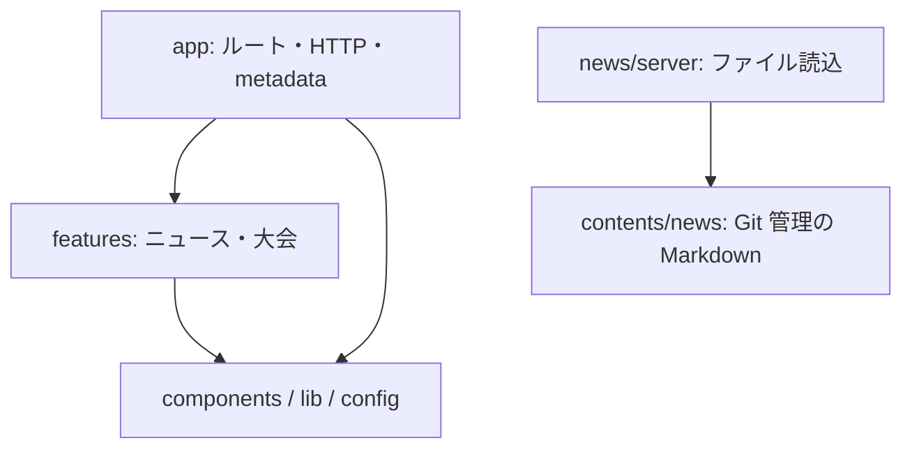

# 神奈川県ライフル射撃協会ウェブサイト

Next.js 16 App Router / React 19。Node.js 24.21.0 と npm 11.19.0 を使用する。
リポジトリのルートで依存関係をインストールする。

```bash
npm ci
[ -f packages/website/.env.local ] || cp packages/website/.env.example packages/website/.env.local
npm run dev
```

開発 URL は `http://localhost:3000`。ニュースはサーバーから Markdown を直接読み込むため、内部 API URL は不要。
旧設定の `API_INTERNAL_URL` と `NEXT_PUBLIC_API_URL` は廃止済みです。既存の環境に残っていれば削除してください。
本番では `NEXT_PUBLIC_URL` に公開 URL を指定する。CDN の既定値は `https://static.kanagawa-rifle.org`。
監視・アクセス解析は対応する環境変数で設定する。空の `NEXT_PUBLIC_SENTRY_DSN` は監視を無効にする。

## 構成と依存方向



- `app` はルートの入力検証と画面の組み立てを担当します。
- `features/news` と `features/competitions` は各機能のモデル、検証、表示を所有します。
- `components` は共通 UI、`lib` は共通処理、`config` は設定を持ちます。機能への逆依存は作りません。
- import は利用するモジュールを直接指定します。異なる機能同士は `app` で組み合わせます。
- `server-only` を付けたニュース読込・HTTP変換・大会データ・Markdown解析はブラウザに取り込みません。
- `npm run lint:architecture` で循環参照、依存方向、再エクスポート経由のクライアント／サーバー境界を検査します。

## データと描画

- `src/contents/news/<年>/<YYYY-MM-DD-NN>.md`: ニュースの本文と front matter。
- `src/features/news/server/news.ts`: サーバー専用の記事列挙・読込・ページング。
- `src/features/news/schema.ts`: front matter とページング入力の検証。
- `src/features/news/types.ts`: スキーマから導出した一覧用 `NewsSummary`、本文付き `NewsItem`、HTTP 用 `NewsItemJson`。
- `src/features/news/server/http.ts`: ISO 日付への変換、API の応答形式、キャッシュ、エラー処理。
- `src/features/news/components`: 記事、一覧、操作部品。表示日付は日本時間で統一します。
- `src/app/news`: 一覧、本文、metadata、JSON-LD をサーバーで生成する。
- `src/app/api/news`: 同じデータアクセスを使う公開 JSON API。
- `src/app/sitemap.ts`: 全記事と実際の公開日・更新日、登録済みの大会年度を列挙する。
- `src/lib/ReactMarkdown`: 本文と目次を一度の解析結果から生成する。
- `src/features/competitions`: 年度別データ、日程の型と検証、ホームと大会ページで共有する表示。

大会年度を追加する際は `src/features/competitions/data/yearYYYY.ts` を作成し、同ディレクトリの
`index.ts` の登録表に追加します。年度一覧、年度ページの静的生成、サイトマップが連動します。
`CURRENT_COMPETITION_YEAR` は編集者が明示的に選択し、今日の日付から自動変更しません。
年度別の名称・URL は `src/config/paths.ts` の `getCompetitionPath` から生成します。

ページの metadata は `src/lib/metadata.ts`、構造化データの出力は `src/components/JsonLd.tsx` を使います。
記事タイトルに `&` や HTML が含まれても、画像 URL と JSON-LD を適切にエスケープします。

ブラウザーでの処理は件数変更、共有、テーマ切替などの操作に限定する。
記事は Git で管理し、追加・修正はデプロイで公開する。詳細ページとホームはビルド時に生成される。
ファイル一覧の独自 TTL や React Query のキャッシュは持たない。
開発サーバーでは Markdown の編集後にページを再読み込みする。

`/news` の `page` は 1 以上、`size` は 1〜128（既定 12）。不正値・範囲外ページは 404。
ホームは常に新着 6 件を表示する。不正 slug と不存在記事も公開ページでは 404。
API は既存の応答形式を維持し、不正 slug は 400、不存在は 404、読込・内容不正は 500。
読込失敗の詳細はサーバーログに記録し、500 応答には内部のパスや入力を返しません。
API の日付は ISO 文字列。一覧には従来どおり `content: ''` を返す。
API のレスポンスキャッシュは一覧 5 分・詳細 10 分、SWR 1 時間を維持する。

## 環境変数

公開設定は `src/config/env.ts` で検証し、秘密の Sentry ビルド設定は `next.config.ts` で読みます。
`NEXT_PUBLIC_CDN_URL` は添付ファイルの URL、画像の許可ホスト、CSP に反映します。
添付ファイルの既定ルートは `<CDN_URL>/website` です。既存の個別設定
`NEXT_PUBLIC_STATIC_FILE_BASE_URL` がある場合はそちらを優先します。
ナビゲーション設定は環境変数や大会データを読み込みません。
環境変数の変更後は再ビルドしてください。

CSP は開発時だけ React のデバッグに必要な `unsafe-eval` を許可します。
本番ビルドでは LHCI を含めて許可しません。
ツールチップとダイアログの対話部品はクライアント境界内で組み立て、初期描画の一致を保ちます。

## 検証

```bash
npm run lint:architecture
npm run -w @acme/website lint:eslint
npm run -w @acme/website typecheck
npm run -w @acme/website test
npm run -w @acme/website test:content
npm run -w @acme/website build
npx playwright install chromium
npm run -w @acme/website test:e2e:dev -- --project=chromium --project="Mobile Chrome"
LHCI=1 npm run -w @acme/website test:e2e -- --project=chromium --project="Mobile Chrome"
npm run -w @acme/website build-storybook
```

Playwright はビルド後に `127.0.0.1:3100` で本番サーバーを起動する。既存サーバーは再利用しない。
ローカル HTTP 検証では `LHCI=1` をビルドと起動の両方に渡し、CSP の HTTPS 強制を無効にする。
`test:e2e:dev` は手動の開発サーバーを停止してから実行します。`127.0.0.1:3200` で開発サーバーを起動し、
ホーム・ニュース・大会のハイドレーション、ブラウザーのエラー・警告、ツールチップとダイアログを検証します。
ニュース読込テストは一時ディレクトリを指定した独立のリポジトリを使い、プロセス全体の作業ディレクトリを変更しません。
全記事検証は Markdown を直接読み、欠落・命名・front matter・日付の不正を検出する。
CI は依存構造の検査、lint、型検査、記事検証、単体テストとカバレッジ、およびデスクトップ・モバイルの公開ページ導線を実行する。

ステージング認証は `src/proxy.ts` で処理する。`VERCEL_GIT_COMMIT_REF=staging` の場合は
`BASIC_AUTH_ID` / `BASIC_AUTH_PASSWORD` を実行環境に設定する。
設定不足は 500、認証失敗は 401。matcher の適用範囲は既存構成を維持する。

## Docker

`docker/node/Dockerfile` も Node.js 24.21.0 を使う。
Docker での公開 URL に合わせ、`packages/website/.env.local` の `NEXT_PUBLIC_URL` を
`https://kanagawa-rifle.org.test` に設定する。
コンテナーは `LOCAL_UID` / `LOCAL_GID`（既定 1000）で実行し、ホストの生成物を root 所有にしない。
必要なら起動前に次を指定する。

```bash
export LOCAL_UID=$(id -u)
export LOCAL_GID=$(id -g)
cd docker
# docker/.env を設定してから実行
# HTTPS プロキシ経由: https://kanagawa-rifle.org.test
docker compose up -d node https-portal
```

既存の root 所有の `node_modules` / `.next` は、所有権を修正するか退避してから再生成する。
ホストとコンテナーで同時にインストール・ビルドしない。

共有設定と環境変数は Turborepo のキャッシュ入力に含めます。lint は CSS、Markdown、flat config も入力に含め、
`LHCI` などのビルド設定が異なる場合は以前の成果物を再利用しません。
設計上の前提は [Next.js のクライアント境界](https://nextjs.org/docs/app/api-reference/directives/use-client) と
[JSON-LD の出力手順](https://nextjs.org/docs/app/guides/json-ld)、
[開発時の CSP](https://nextjs.org/docs/app/guides/content-security-policy#development-vs-production-considerations)、
[Madge の依存解析](https://github.com/pahen/madge)を参照してください。
